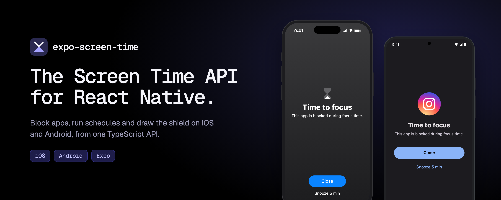

<a href="https://magrinj.github.io/expo-screen-time/">
  
</a>

<div align="center">

[](https://www.npmjs.com/package/expo-screen-time)
[](https://www.npmjs.com/package/expo-screen-time)
[](https://github.com/magrinj/expo-screen-time/actions/workflows/ci.yml)
[](https://magrinj.github.io/expo-screen-time/docs/platform-support/)
[](./LICENSE)

**[Documentation](https://magrinj.github.io/expo-screen-time/docs/)** · **[Quick start](#quick-start)** · **[Platform support](https://magrinj.github.io/expo-screen-time/docs/platform-support/)** · **[Example app](./example)**

</div>

Block apps, run schedules and draw the shield on **iOS and Android**, from one TypeScript API built for Expo. If you ship a focus, digital wellbeing or parental-control app, this is the native layer.

On iOS, it wraps Apple's Screen Time APIs (FamilyControls, ManagedSettings, DeviceActivity), and the config plugin generates the four app extensions they need: no Xcode surgery. Android has no Screen Time API, so the module ships its own enforcement engine behind the same calls.

```tsx
import ExpoScreenTime, { ActivityPicker } from 'expo-screen-time';

await ExpoScreenTime.requestScreenTimePermissionsAsync();

<ActivityPicker selectionId="focus" style={{ flex: 1 }} />;

ExpoScreenTime.blockSelection('focus');
```

## Features

- 🔐 **Permissions in one call.** The steps the user must allow come back as data: the Family Controls prompt on iOS, the Settings toggles on Android, one screen at a time.
- 🚫 **App blocking.** Block what the user picks in the native picker, as a blocklist or an allowlist.
- ⏰ **Schedules.** Time windows and usage thresholds that keep enforcing while your app is closed, with events back to JS.
- 🛡️ **Custom shields.** Style the blocking screen and its buttons: close, snooze, unblock, open your app.
- ⏳ **Earned time.** Temporary unlocks that re-lock on their own.
- 📊 **Usage reports.** Report templates written in JSX, rendered natively. Usage data never reaches JavaScript.
- 🏷️ **Token labels.** App names and icons drawn from opaque handles, so your JS never learns what someone picked.
- 🌐 **Web domains and App Store restrictions.** Block domains (iOS), and prevent installing or removing apps.

### iOS and Android, honestly

|  | iOS | Android |
|---|---|---|
| Enforced by | The OS (Screen Time) | The module's own engine, a foreground service |
| Can the user turn it off? | No | Yes, from Settings. `getEnforcementGaps()` reports when. |
| Categories and web domains | ✅ | Not yet |

The full per-API matrix is on [Platform support](https://magrinj.github.io/expo-screen-time/docs/platform-support/).

## Quick start

**Requirements:** Expo SDK 54+ (tested on SDK 58), iOS 16+, Android 7+ (API 24), and a [development build](https://docs.expo.dev/develop/development-builds/introduction/): the module cannot run in Expo Go. On iOS, your Apple Developer account needs the Family Controls capability.

**1. Install**

```bash
npx expo install expo-screen-time
```

**2. Add the config plugin** to `app.json`

```json
{
  "expo": {
    "ios": { "bundleIdentifier": "com.yourcompany.yourapp", "appleTeamId": "YOUR_TEAM_ID" },
    "android": { "package": "com.yourcompany.yourapp" },
    "plugins": ["expo-screen-time"]
  }
}
```

**3. Prebuild and run**

```bash
npx expo prebuild --clean
npx expo run:ios      # or npx expo run:android
```

On iOS, prebuild generates the extension targets. On Android there is nothing to configure: the library's manifest brings the permissions and the engine's service.

> [!TIP]
> Re-run `npx expo prebuild --clean` after upgrading `expo-screen-time` or changing `ios.bundleIdentifier`. See [Configuration](https://magrinj.github.io/expo-screen-time/docs/configuration/).

## Documentation

Everything lives at **[magrinj.github.io/expo-screen-time](https://magrinj.github.io/expo-screen-time/docs/)**:

- [Configuration](https://magrinj.github.io/expo-screen-time/docs/configuration/): extension targets, App Group, plugin options
- [API reference](https://magrinj.github.io/expo-screen-time/docs/api/importing/): permissions, blocking, schedules, shields, reports
- [Components](https://magrinj.github.io/expo-screen-time/docs/components/): activity picker, activity report, token labels
- [Troubleshooting](https://magrinj.github.io/expo-screen-time/docs/troubleshooting/)

## Example app

[`example/`](./example) exercises every feature on both platforms:

```bash
cd example && bun install
bun run ios       # or bun run android
```

## Authors

<table>
  <tr>
    <td align="center" width="50%">
      <a href="https://github.com/magrinj"></a><br />
      <b><a href="https://github.com/magrinj">Jérémy Magrin</a></b><br />
      <sub>Created the library and built the iOS side from the first proof of concept: Family Controls, the shield and DeviceActivity extensions, the config plugin that generates them, the report templates, and the release pipeline.</sub><br /><br />
      <a href="https://buymeacoffee.com/magrinj"></a>
    </td>
    <td align="center" width="50%">
      <a href="https://github.com/VirtuozTM"></a><br />
      <b><a href="https://github.com/VirtuozTM">Armand Petit</a></b><br />
      <sub>Designed and built the Android port, tested on real devices: the enforcement engine, the picker, schedules, the shield and usage reports. Also hardened iOS with a round of fixes, the allowlist mode and typed errors.</sub>
    </td>
  </tr>
</table>

### Contributors

<a href="https://github.com/magrinj/expo-screen-time/graphs/contributors">
  
</a>

Contributions are welcome: read [CONTRIBUTING.md](./CONTRIBUTING.md) first.

## Acknowledgements

- [expo-widgets](https://github.com/expo/expo/tree/main/packages/expo-widgets), Expo's first-party approach to generating Apple targets, which the config plugin follows
- [@bacons/apple-targets](https://github.com/EvanBacon/expo-apple-targets) by Evan Bacon, the original inspiration
- Apple's [Screen Time API](https://developer.apple.com/documentation/familycontrols) documentation

## License

[MIT](./LICENSE)
